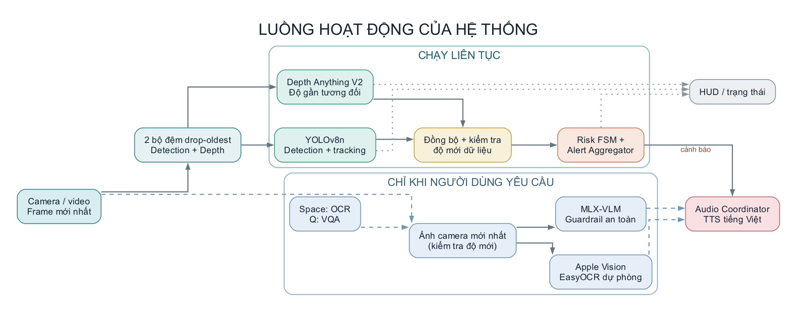

# Hệ thống AI đa phương thức hỗ trợ người khiếm thị

[](https://github.com/lqmnhat13/Do-An-Tot-Nghiep/actions/workflows/cicd.yml)

Đồ án xây dựng một ứng dụng **chạy cục bộ trên macOS Apple Silicon** để mô tả môi trường qua âm thanh tiếng Việt. Camera cung cấp ảnh cho phát hiện vật thể, ước lượng **khoảng cách (mét, cần hiệu chỉnh theo camera)** và cảnh báo va chạm; OCR và hỏi đáp thị giác (VQA) chỉ chạy khi người dùng yêu cầu. Runtime không cần cloud API hay telemetry. Việc tải model là bước chuẩn bị riêng, cần mạng khi tài nguyên chưa có.

**Trạng thái đối chiếu ngày 11/10/2026:** đã có ứng dụng tích hợp camera/video, detection, tracking, depth, đánh giá nguy cơ, OCR, VQA và âm thanh; bộ test offline trên máy phát triển chạy **135 test, tất cả đạt**. Đây vẫn là nguyên mẫu, chưa có đánh giá thực địa đủ để khẳng định độ tin cậy cho sử dụng độc lập. Các mục dưới mô tả mã nguồn và cấu hình hiện tại, không xem nội dung trong các file `PLAN_*.md` là chức năng đã hoàn thành.

> **Lưu ý an toàn:** Đây là nguyên mẫu nghiên cứu, không phải thiết bị dẫn đường đã được chứng nhận. Model có thể bỏ sót vật cản, đọc sai chữ hoặc mô tả sai ảnh. VQA không xác nhận đường đi an toàn; người dùng vẫn cần gậy dẫn đường, kỹ năng định hướng và hỗ trợ phù hợp.

## Mục lục

- [Chức năng và luồng hoạt động](#chức-năng-và-luồng-hoạt-động)
- [Yêu cầu và model](#yêu-cầu-và-model)
- [Cài đặt và chạy nhanh](#cài-đặt-và-chạy-nhanh)
- [Sử dụng ứng dụng](#sử-dụng-ứng-dụng)
- [Cấu hình thực tế](#cấu-hình-thực-tế)
- [Kiểm thử và đánh giá](#kiểm-thử-và-đánh-giá)
- [Giới hạn và an toàn](#giới-hạn-và-an-toàn)
- [Cấu trúc và tài liệu](#cấu-trúc-và-tài-liệu)
- [Giấy phép và nguồn model](#giấy-phép-và-nguồn-model)

## Chức năng và luồng hoạt động



[Nguồn sơ đồ Graphviz](docs/architecture-flow.dot) có thể sửa và xuất lại bằng `dot -Tpng -Gdpi=120 docs/architecture-flow.dot -o docs/architecture-flow.png`.

| Thành phần | Vai trò | Thời điểm chạy |
| --- | --- | --- |
| Camera và bộ đệm | Một luồng thu ảnh, phân phối qua hai bộ đệm `drop-oldest` để bỏ frame cũ khi xử lý chậm. | Liên tục |
| Detection + tracking | YOLOv8n lọc 24 lớp COCO theo cấu hình; `ByteTrackerAdapter` gán `track_id` bằng ghép IoU cùng lớp. Đây là tracker đơn giản, chưa phải triển khai đầy đủ thuật toán ByteTrack. | Liên tục |
| Depth + đồng bộ | Depth Anything V2 Metric-Indoor ước lượng khoảng cách (mét, nhân `metric_scale`); bộ đồng bộ kiểm tra độ mới và ghép với detection. | Liên tục |
| Risk FSM + âm thanh | Đánh giá rủi ro từ dữ liệu hợp lệ; chỉ phát cảnh báo HIGH trong chế độ Cảnh báo. | Đánh giá liên tục; phát theo chế độ |
| OCR | Apple Vision trên macOS; EasyOCR dự phòng nếu Vision lỗi khi khởi tạo hoặc khi đọc. Ảnh nghi mờ/tối/lóa vẫn được đọc thử, chỉ hướng dẫn chụp lại khi không đọc ra chữ; tiền xử lý và sắp thứ tự đọc bằng hình học. | Khi bấm `Space` |
| VQA | Qwen2.5-VL qua MLX-VLM mặc định; kiểm tra câu hỏi trước inference và lọc lời khẳng định an toàn trong câu trả lời. | Khi bấm `Q` |
| HUD | Hiển thị ảnh camera, bbox, hành lang, mức nguy cơ, depth và trạng thái/hiệu năng; kết quả OCR/VQA được phát qua TTS. | Khi bật GUI |

Khi OCR hoặc VQA đang xử lý, detection và depth vẫn tiếp tục chạy. Chọn OCR/VQA sẽ dừng và tắt toàn bộ cảnh báo vật cản, kể cả `HIGH_RISK`, cho đến khi bấm `C` chuyển về chế độ Cảnh báo; MEDIUM/LOW chỉ dùng để hiển thị thông tin và không phát âm thanh trong mọi chế độ. Khi dữ liệu detection/depth trễ hoặc không đạt chất lượng, hệ thống không tự suy ra rằng môi trường an toàn.

Cảnh báo vật cản xét các lớp thuộc `alert_classes` có bounding box giao đủ với hành lang hình thang và phần gần nhất của vật trong **1,5 m** (HIGH; MEDIUM ≤ 2,5 m, LOW ≤ 3,5 m — `risk_fsm.distance_threshold_*_m`). Ngoài ra, nếu ≥ 15% vùng hành lang chưa có vật được nhận diện (bỏ dải sàn 25% đáy ảnh) gần hơn **1,0 m**, hệ thống phát cảnh báo chung "vật cản" — cho tường, mặt bàn, cạnh tủ… mà YOLO không biết (`generic_obstacle` trong `configs/fusion_rules.yaml`). Chỉ HIGH phát âm thanh và banner cảnh báo; MEDIUM/LOW vẫn được tính, nhưng không phát cảnh báo hoặc kích hoạt cooldown. Nhãn MEDIUM trên bbox là `TRUNG BINH`. HUD hiển thị hành lang bằng nhãn `VUNG XET VAT CAN`; trái/phải/giữa chỉ mô tả vị trí. Khi bbox ra ngoài hành lang hoặc độ gần giảm dưới ngưỡng, FSM hạ mức ngay; cooldown và ưu tiên tăng mức vẫn được giữ.

Điều chỉnh `walking_corridor` trong `configs/fusion_rules.yaml`: `center_x=0.50`, `top_y=0.35`, `top_width=0.20`, `bottom_width=0.60` đều theo tỷ lệ ảnh; `min_overlap_ratio=0.10` là diện tích giao chia cho diện tích nhỏ hơn giữa bbox đã clamp và hành lang. Camera cần hướng theo hướng đi; tinh chỉnh bằng video từ vị trí gắn camera thực tế. Hình thang là vùng ước lượng trên ảnh, không xác nhận đường đi an toàn hoặc khoảng cách theo mét. Tùy chọn cũ `instant_high_risk_in_center` hiện áp dụng cho HIGH trong hành lang ở mọi hướng; `confirmations_to_deescalate` được giữ để tương thích nhưng không giữ mức cảnh báo cũ.

Bộ đồng bộ ưu tiên depth cùng `frame_id`, nếu chưa có thì dùng depth mới nhất và kiểm tra timestamp. Cấu hình hiện tại giới hạn lệch cặp ở **600 ms**, tuổi detection **1.000 ms**, tuổi depth **1.200 ms** và tuổi nguồn cảnh báo **1.500 ms**. FSM chỉ tính nguy cơ khi dữ liệu `VALID` và ROI đủ pixel hợp lệ; các trường hợp thiếu/cũ/lệch dữ liệu trả mức `UNDETERMINED`. Với `metric_depth` (mặc định), khoảng cách của vật là phân vị 20 (phần gần nhất) độ sâu trong ROI co viền 15%, rồi quy đổi sang điểm 0–1 để FSM/HUD dùng chung ngưỡng; điểm không phụ thuộc phần còn lại của khung hình. Với `relative_depth` (cấu hình cũ), độ gần được chuẩn hoá min-max theo từng khung hình nên vật gần thường bị đánh giá thấp khi sàn sát camera còn gần hơn — xem [đánh giá trên dữ liệu thật](evaluation/REAL_DATA_EVALUATION.md).

**Hiệu chỉnh khoảng cách:** thang mét của model lệch theo camera và độ phân giải đầu vào (trên NYU ở 256 px, model ước lượng xa hơn thực tế ~1,66 lần, nên mặc định `depth.metric_scale: 0.60`). Với camera thật, đặt camera đối diện một mặt phẳng ở 2–3 khoảng cách đã đo bằng thước rồi chạy `python scripts/calibrate_depth.py --distance 1.0` (lặp lại với 1.5, 2.0; thêm `--write` để ghi hệ số vào YAML).

## Yêu cầu và model

- **Nền tảng mục tiêu:** macOS trên Apple Silicon M1, 16 GB unified memory; cần cấp quyền Camera cho ứng dụng Terminal khi dùng webcam.
- **Python:** lần kiểm thử ngày 11/10/2026 dùng Python **3.10.20** trong Conda `ai-macbook` trên macOS arm64.
- **Tăng tốc:** PyTorch MPS cho detection/depth; MLX cho VQA mặc định. Một số thành phần có thể dùng CPU hoặc fallback, nhưng độ trễ sẽ khác.
- **Âm thanh:** lệnh `say` của macOS, ưu tiên giọng tiếng Việt `Linh`; cần kiểm tra giọng này trên máy chạy.
- **Trọng số:** YOLO ở `models/weights/yolov8n.pt`; các model Hugging Face cần có trong cache hoặc thư mục local trước khi chạy offline. Snapshot VQA MLX được lưu tại `models/weights/qwen2_5_vl_3b_4bit` theo cấu hình hiện tại.

| Tác vụ | Model/backend mặc định | Cấu hình |
| --- | --- | --- |
| Phát hiện vật thể | YOLOv8n, lọc các lớp COCO liên quan | `configs/model_config.yaml` → `detection` |
| Khoảng cách | Depth Anything V2 Metric-Indoor Small (bản relative Small vẫn chọn được) | `configs/model_config.yaml` → `depth` |
| OCR | Apple Vision; EasyOCR tiếng Việt/Anh dự phòng | `configs/model_config.yaml` → `ocr` |
| VQA | Qwen2.5-VL-3B-Instruct-4bit qua MLX-VLM; backend BLIP + MarianMT là lựa chọn legacy | `configs/model_config.yaml` → `vqa` |
| TTS | `say` của macOS và các WAV cảnh báo | `configs/app_config.yaml` → `audio` |

`mlx-vlm` là dependency cài riêng, không nằm trong `requirements.txt`. Model VQA được nạp khi có yêu cầu, không nạp ở lúc khởi động. Nếu backend/model VQA không khả dụng, dịch vụ có thể dùng ngữ cảnh detection làm câu trả lời dự phòng; điều này không tương đương một câu trả lời VQA chính xác.

Backend MLX chỉ nhận **thư mục model local** có `config.json` và trọng số `.safetensors`; runtime không tải từ Hub. Ảnh được thu nhỏ giữ tỷ lệ/toàn khung hình, cạnh dài nhất tối đa **512 px**; đầu ra tối đa **128 token**. Prompt yêu cầu 1–2 câu tiếng Việt, tối đa 40 từ, và luôn nhắc người/con vật nếu có khi mô tả cảnh; bộ kiểm tra loại câu trả lời quá 45 từ, không đúng 1–3 câu hoàn chỉnh, thiếu dấu kết câu hoặc có dấu hiệu chạm giới hạn token. Những trường hợp này chuyển sang fallback. Câu phát cuối có thể dài hơn vì bổ sung tối đa ba đối tượng từ ngữ cảnh detection/depth còn mới. `legacy_caption` chỉ tạo caption BLIP rồi dịch bằng MarianMT, chưa dùng câu hỏi để điều khiển nội dung; `disabled` chỉ dùng fallback, không tự chuyển sang một VLM khác.

Môi trường đã chạy test có `torch 2.12.0`, `transformers 5.17.0`, `ultralytics 8.4.138`, `mlx-vlm 0.7.0` và `pyobjc-framework-Vision 12.2.2`. Đây là ghi nhận của máy phát triển, không phải bộ phiên bản khóa: `requirements.txt` hiện dùng các giới hạn tối thiểu và chưa có lockfile.

## Cài đặt và chạy nhanh

Nếu đã clone dự án hoặc có môi trường `ai-macbook`, bỏ qua các lệnh tương ứng. Các lệnh còn lại chạy từ thư mục gốc dự án.

```bash
git clone https://github.com/lqmnhat13/Do-An-Tot-Nghiep.git
cd Do-An-Tot-Nghiep
conda create -n ai-macbook python=3.10 -y
conda activate ai-macbook
python -m pip install -r requirements.txt
python -m pip install mlx-vlm
```

Chuẩn bị tài nguyên khi **có mạng**:

```bash
python scripts/download_models.py
python scripts/download_models.py --mlx-vlm
```

Lệnh đầu chuẩn bị YOLO, Depth Anything, EasyOCR, backend VQA legacy và các WAV mẫu; lệnh thứ hai tải riêng snapshot MLX-VLM mặc định. Lệnh đầu có thể tạo lại WAV và một số lỗi tải được in ra nhưng không nhất thiết làm tiến trình trả mã lỗi khác `0`: hãy đọc từng dòng `[OK]`/`[FAIL]`, rồi kiểm tra môi trường bằng `python scripts/inspect_environment.py`. Không cần tải lại nếu tài nguyên đã có.

Depth (bản Metric-Indoor trong cấu hình và bản relative Small) và BLIP/MarianMT được lưu trong **cache Hugging Face của tài khoản chạy script**, EasyOCR dùng cache riêng. Apple Vision dùng framework hệ thống, không cần tải trọng số EasyOCR để chạy nhánh Vision, nhưng cần cache EasyOCR nếu muốn dùng dự phòng.

Sau khi chuẩn bị, chạy **offline nghiêm ngặt**:

```bash
export SECOND_EYE_OFFLINE=1
export HF_HUB_OFFLINE=1
export TRANSFORMERS_OFFLINE=1
export YOLO_OFFLINE=1
python app.py --source 0
```

Không đặt các biến offline khi chủ động tải model. `--source 0` là webcam mặc định; có thể thay bằng đường dẫn video. Nếu macOS báo không mở được camera, kiểm tra quyền Camera của Terminal hoặc ứng dụng đang chạy lệnh. Khi chỉ cần kiểm tra khởi động/tắt mà không dùng webcam:

```bash
python app.py --source dummy --no-gui --duration 5
```

Nguồn `dummy` là ảnh giả lập, **không** chứng minh hệ thống hoạt động chính xác với camera thật.

Runtime mặc định bật chính sách local-only qua `SECOND_EYE_OFFLINE=1`; các biến bổ sung ở trên áp dụng thêm chế độ offline cho thư viện. YOLO thiếu file trọng số sẽ làm khởi động thất bại. Depth thiếu cache trả bản đồ có mask không hợp lệ, vì vậy không đủ căn cứ phát cảnh báo. OCR thiếu engine/model trả lỗi; VQA thiếu model dùng fallback. Camera mở thất bại quá số lần thử có thể **tự chuyển sang dummy**: nếu thấy `Dummy Cam`, đó là ảnh giả lập, không phải camera đã phục hồi.

## Sử dụng ứng dụng

| Phím | Tác dụng |
| --- | --- |
| `Space` | Chụp frame mới và đọc chữ bằng OCR. |
| `Q` | Hỏi VQA theo câu mặc định “Mô tả khung cảnh phía trước”. |
| `C` | Chuyển về chế độ Cảnh báo, dừng lời OCR/VQA và hủy hiệu lực kết quả đang chờ. |
| `S` | Dừng giọng đọc và hủy kết quả OCR/VQA đang chờ; giữ nguyên chế độ đã chọn. |
| `Esc` | Thoát cửa sổ và dừng hệ thống. |

Khởi động ở chế độ Cảnh báo. Khi được chấp nhận, `Space`/`Q` vừa chọn chế độ OCR/VQA vừa xử lý ảnh camera mới nhất, tuổi không quá **1 giây**; hoàn tất, lỗi hoặc thiếu ảnh đều giữ chế độ đó. Bấm lại để xử lý ảnh mới. Chỉ `C` bật lại cảnh báo từ nguồn ảnh sau lúc chuyển chế độ. Nếu worker cũ còn chạy, yêu cầu OCR/VQA mới bị từ chối; `C` vẫn chuyển về Cảnh báo ngay. `S`/`C` hủy hiệu lực kết quả muộn và ngắt âm thanh, nhưng không cưỡng bức dừng inference đang chạy hoặc giải phóng model khỏi RAM.

Các phím trên chỉ hoạt động khi cửa sổ GUI có focus. Ở chế độ `--no-gui`, dùng `Ctrl+C` để dừng; không có thao tác OCR/VQA qua phím tắt GUI. Nếu cần thử riêng OCR trên ảnh hoặc đổi câu hỏi VQA trên webcam, dùng các CLI phụ trong [CLI.md](CLI.md). Hai CLI phụ đó **không** chạy pipeline cảnh báo; để thử trải nghiệm đầy đủ, dùng `app.py`.

## Cấu hình thực tế

Ứng dụng đọc ba YAML khi khởi động từ thư mục gốc. Đổi cấu hình cần khởi động lại; không phải mọi khóa đang có đều được áp dụng.

| File | Các cấu hình đã nối vào ứng dụng chính |
| --- | --- |
| `configs/app_config.yaml` | Device chung, nguồn/kích thước/FPS camera, giọng/tốc độ TTS, kích thước preview và hai cờ HUD `show_depth_map`, `show_spatial_guides`. |
| `configs/model_config.yaml` | Trọng số/ngưỡng confidence/danh sách lớp YOLO; repo/kích thước inference/ROI depth; engine/ngôn ngữ/ngưỡng confidence và chất lượng OCR; backend và cấu hình con `vqa.mlx_vlm`. |
| `configs/fusion_rules.yaml` | Hành lang, vùng trái/giữa/phải, ngưỡng stale/skew, ngưỡng HIGH/MEDIUM/LOW, xác nhận tăng mức, cooldown, nhãn vật thể tiếng Việt và thời hạn cảnh báo. |

Các điểm cần lưu ý khi điều chỉnh:

- `--source`, `--weights`, `--device` ghi đè giá trị YAML tương ứng. Device chung điều khiển YOLO/depth và nhánh PyTorch/EasyOCR; `--device cpu` không chuyển backend MLX sang CPU.
- `camera.buffer_size` chưa điều khiển bộ đệm: runtime hiện tạo hai buffer, mỗi buffer **2 frame**, giữ `drop-oldest`. Các khóa reconnect trong YAML chưa được truyền vào camera; lớp dùng mặc định 2 giây/lần và tối đa 5 lần trước điều kiện chuyển dummy.
- `runtime.detection_interval_ms`, `depth_interval_ms`, `watchdog_timeout_sec` chưa nối vào worker: detection xử lý khi có frame, depth dùng khoảng nhịp 125 ms, watchdog dùng 3 giây. Các giá trị này không bảo đảm FPS thực tế.
- `audio.enabled`, `audio.engine`, `audio.enable_chimes`, `audio.min_alert_interval_sec` chưa nối vào điều phối âm thanh. Cooldown thực tế nằm trong cấu hình fusion: mặc định 4 giây mỗi track và 3,5 giây giữa cảnh báo. Dùng `--no-gui` để tắt cửa sổ; `runtime.enable_preview` chưa điều khiển việc này.
- Các khóa device riêng từng model, `detection.model_name`, `detection.iou_threshold`, `detection.input_size`, `vqa.max_tokens` cấp ngoài và `ui.show_diagnostics` chưa được dùng làm tùy chọn runtime tương ứng. YOLO dùng mặc định IoU 0,45/input 640. `depth.representation` (`metric_depth` | `relative_depth`) và `depth.metric_scale` được dùng; khi đổi sang `relative_depth` phải đổi `hf_repo_id` về `Depth-Anything-V2-Small-hf`, và cảnh báo vật cản chung tự tắt vì cần mét. Giới hạn token MLX lấy từ **`vqa.mlx_vlm.max_tokens`** và luôn bị chặn ở 128.

## Kiểm thử và đánh giá

Chạy toàn bộ unit test trong môi trường `ai-macbook` đã kích hoạt. [AGENTS.md](AGENTS.md) cũng ghi lệnh tương đương với đường dẫn Python cố định trên máy phát triển:

```bash
HF_HUB_OFFLINE=1 TRANSFORMERS_OFFLINE=1 PYTHONPATH=. \
python -m unittest discover -s tests -p 'test_*.py' -v
```

**Kết quả kiểm tra ngày 11/10/2026:** lệnh chuẩn dùng `/opt/anaconda3/envs/ai-macbook/bin/python` chạy **135 test trong 12,468 giây**, kết thúc `OK`, mã thoát `0`. Suite bao phủ contracts, buffer, tracking, ROI, đồng bộ dữ liệu stale, hành lang, cảnh báo/âm thanh theo chế độ, OCR, guardrail VQA, adapter MLX, CLI, HUD, hủy kết quả muộn và shutdown. Có test pipeline với nguồn dummy và test Apple Vision trên ảnh chữ tạo sẵn; nhiều ca khác dùng mock/stub. Kết quả này không phải benchmark VQA model thật hay phép thử camera/loa ngoài đời. Lần chạy này không tái hiện lỗi native MLX/nanobind từng được ghi trong tài liệu cũ; chưa đủ để kết luận mọi tổ hợp dependency đều tránh được lỗi đó.

Thử riêng các chức năng trên dữ liệu thật:

```bash
python scripts/run_ocr_camera.py --image /duong/dan/anh.jpg --no-speech
python scripts/run_vqa_camera.py --camera 0 --backend mlx_vlm --no-speech
python scripts/evaluate_video.py --video /duong/dan/video.mp4 --duration 30 \
  --out evaluation/results/eval_video_local.json
```

`run_vqa_camera.py` hiện chỉ nhận webcam, không có `--image`; thêm `--question "Chiếc cốc có màu gì?"` để đổi câu hỏi gửi khi bấm `Q`. `run_ocr_camera.py` hỗ trợ webcam hoặc `--image`; `--no-speech` bỏ TTS. Hai công cụ in kết quả trong Terminal và không chạy detection/depth/cảnh báo.

`evaluate_video.py` ghi báo cáo JSON mặc định tại `evaluation/results/eval_report.json`; ví dụ trên dùng output riêng để giữ báo cáo cũ. Script đọc cấu hình fusion nhưng dùng mặc định cho nhiều thành phần camera/model/audio, nên không tương đương hoàn toàn với `app.py`. Báo cáo hiện ghi FPS/latency, chưa đo độ chính xác, recall vật cản hay tỷ lệ cảnh báo sai. Metric `end_to_end` chỉ đo vòng xử lý detection/tracking/fusion, chưa bao gồm toàn bộ thời gian từ camera đến âm thanh; `total_frames_processed` đang lấy `frame_id` gần nhất, không phải số frame thực sự đã inference.

`benchmark_vqa_backends.py` nhận bộ ảnh và câu hỏi JSONL để đo độ trễ/lỗi và hỗ trợ chấm thủ công; xem cú pháp trong [CLI.md](CLI.md). **CLI benchmark hiện chưa truyền cấu hình đường dẫn model cho `mlx_vlm`**, nên chọn `--backend mlx_vlm` sẽ không benchmark được model đó; cần bổ sung wiring trong script trước. Backend `legacy_caption` dùng được khi có cache, nhưng chỉ mô tả ảnh rồi dịch, không trả lời theo câu hỏi. Benchmark gọi backend trực tiếp, không kiểm tra toàn bộ guardrail/dịch vụ VQA.

**Cách đọc kết quả:** unit test và nguồn `dummy` chứng minh hành vi phần mềm ở các ca đã viết, không phải độ chính xác ngoài đời. Đánh giá định lượng trên dữ liệu công khai có nhãn (COCO, NYU Depth V2, TUM RGB-D, VinText, ICDAR 2015, SROIE, OpenViVQA, KTVIC) nằm trong [evaluation/REAL_DATA_EVALUATION.md](evaluation/REAL_DATA_EVALUATION.md), script trong `evaluation/benchmarks/`; vẫn chưa có thử nghiệm thực địa với người dùng đủ để kết luận mức tin cậy cho sử dụng độc lập. Khi công bố số liệu, cần ghi nguồn dữ liệu, số mẫu, cách gán nhãn, metric, thiết bị, phiên bản model và ngày đo.

Báo cáo đang được quản lý trong Git tại `evaluation/results/eval_report.json` dùng nguồn **dummy, thời lượng 1 giây**; không dùng các số liệu đó như kết quả trên video thực tế. Các thư mục `artifacts/` trên máy phát triển bị Git bỏ qua, không phải bộ dữ liệu/đánh giá được phân phối cùng repo. CI có workflow lint/test/evaluation/đóng gói trên Ubuntu CPU; badge CI không thay thế kiểm thử macOS M1 và trạng thái workflow mới nhất chưa được kiểm tra trong lần cập nhật tài liệu này.

## Giới hạn và an toàn

- Khoảng cách từ Depth Anything V2 Metric-Indoor là **ước lượng**: trên NYU sau hiệu chỉnh, sai số trung vị khoảng 0,2 m nhưng có ca lệch hơn 0,7 m; hệ số `metric_scale` phải hiệu chỉnh lại cho từng camera. Câu cảnh báo không đọc số mét.
- Camera mờ, lóa, bị che, thiếu sáng, ngoài khung hình hoặc vật thể ngoài các lớp detection có thể gây bỏ sót. Không có cảnh báo không có nghĩa là an toàn.
- OCR có thể đọc sai biển hiệu/chữ nhỏ; VQA có thể nhầm đối tượng, suy diễn hoặc trả lời quá ngắn/dài. Không dùng hai chức năng này làm nguồn xác nhận an toàn di chuyển.
- OCR sắp thứ tự theo tọa độ dòng và khoảng cách chữ, chưa phân tích đầy đủ bố cục nhiều cột/bảng. EasyOCR chậm hơn Vision nhiều (0,5–7,6 s/ảnh) và kém chính xác hơn. Guardrail VQA phân loại ý định bằng biểu thức chính quy (hỏi người dùng có di chuyển được không, hỏi vật cản/nguy hiểm), không bảo đảm phát hiện mọi cách diễn đạt.
- Dữ liệu detection/depth trễ hoặc không hợp lệ bị loại khỏi đánh giá rủi ro; hệ thống không phát cảnh báo dựa trên kết quả stale. Điều này cũng đồng nghĩa có thể **không có cảnh báo** khi dữ liệu kém chất lượng.
- Xử lý trên M1 16 GB có thể thay đổi theo bộ model, tải hệ thống và trạng thái nóng/lạnh của model. Chưa có cam kết về latency, RAM hoặc độ chính xác cho mọi cảnh.

## Cấu trúc và tài liệu

| Đường dẫn | Nội dung |
| --- | --- |
| `app.py` | Entry point ứng dụng đầy đủ. |
| `src/camera/`, `src/detection/`, `src/depth/`, `src/tracking/` | Thu ảnh, phát hiện, độ sâu và tracking. |
| `src/fusion/`, `src/audio/`, `src/runtime/` | Đồng bộ, đánh giá rủi ro, cảnh báo và điều phối thread. |
| `src/ocr/`, `src/vqa/`, `src/ui/` | OCR, VQA và HUD. |
| `configs/` | Cấu hình ứng dụng, model và fusion. |
| `scripts/`, `tests/`, `evaluation/` | CLI phụ, unit test và kết quả đánh giá. |
| `models/manifest.json` | Thông tin nguồn và giấy phép các model được khai báo. |

Tài liệu bổ sung: [danh sách CLI](CLI.md), [hướng dẫn sử dụng](HUONG_DAN_SU_DUNG.md), [phân tích kiến trúc](PHAN_TICH_DU_AN.md). Các tài liệu này có thể còn ghi nhận từ phiên bản trước, như giới hạn VQA 64 token hoặc lỗi test ngày 17/09/2026; đối chiếu mã nguồn và README hiện tại khi có khác biệt. `.gitignore` bỏ qua model tải mới trong `models/weights/`, nhưng **`models/weights/yolov8n.pt` hiện đã được Git theo dõi**. Cache Hugging Face/EasyOCR và snapshot MLX vẫn cần chuẩn bị trên từng máy.

## Giấy phép và nguồn model

[models/manifest.json](models/manifest.json) ghi nguồn, giấy phép và trạng thái sử dụng (`active`, `fallback`, `legacy`) của các model/thành phần, khớp với cấu hình hiện tại (**24 lớp nhận diện, 13 lớp cảnh báo**); giấy phép của `Helsinki-NLP/opus-mt-en-vi` chưa được xác minh. Hãy kiểm tra lại điều khoản của **từng** model và dependency trước khi phân phối sản phẩm. Repo hiện **chưa có file `LICENSE` cho mã nguồn dự án**, nên README này không tự cấp quyền sử dụng lại mã nguồn. Nếu phát hành công khai, cần chọn giấy phép cho phần mã nguồn và rà soát tính tương thích với giấy phép model.
